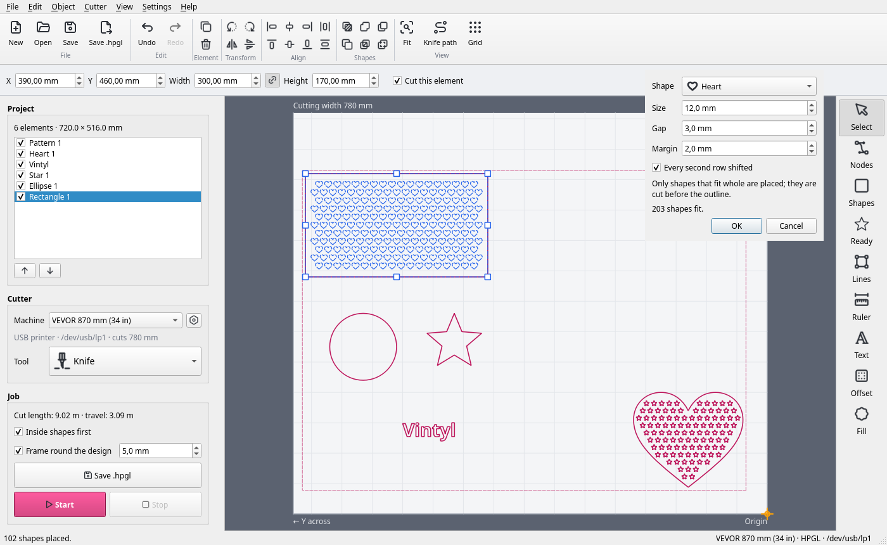
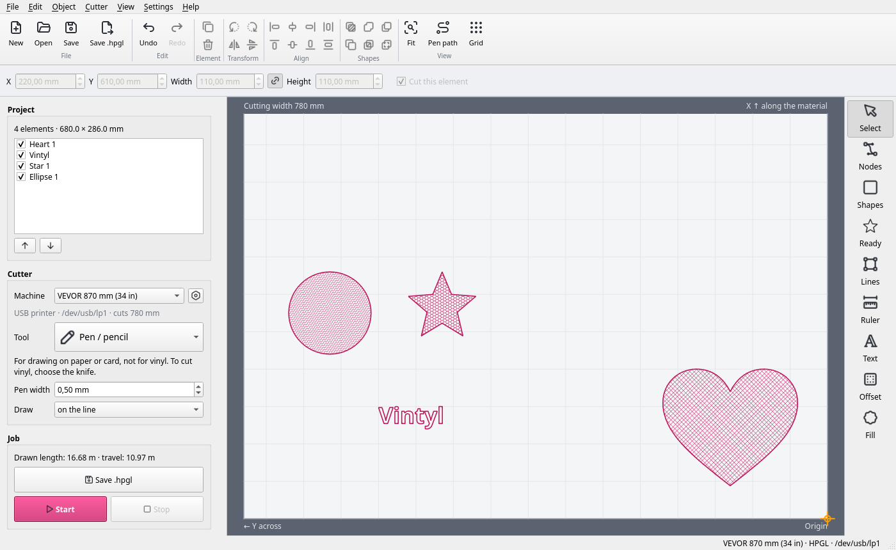
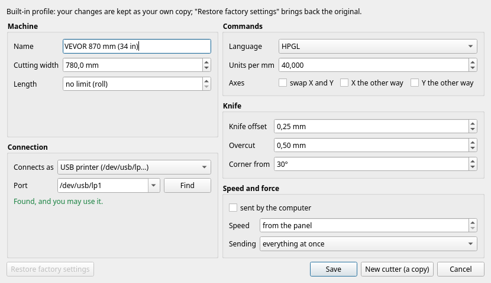

<p align="center"></p>

# Vintyl

**Software for vinyl cutters, for Linux.** Draw a design or open an SVG
file, see it on the sheet as you see the material in the cutter, and cut it,
straight from the window. Vintyl talks to drag-knife vinyl cutters in HPGL
or DMPL, connected as a USB printer or over a serial (or USB-serial) port.

It is made for the cheap and popular cutters that come with Windows-only
software (SignMaster, SignCut), so they can be used on Linux without it.

> **Status: first test version (0.1.0a1, pre-release).** Vintyl is tested
> on a **VEVOR KI-375A** connected by USB as a printer: it cuts from the
> window (and from the AppImage) cleanly. VEVOR's larger cutters are said to
> use the same control board and connect the same way, so they **should
> work the same**; their profile (VEVOR 870 mm) is still to be checked on
> the machine. Please report how it goes on your cutter in the
> [issues](https://github.com/cyryllo/vintyl/issues).


## What it does now

**Cutting**
- **Start and Stop** from the window, with a short check list before
  cutting and a progress bar; or **Save .hpgl** to cut it some other way.
- **Knife compensation** at the corners only (curves are cut smoothly),
  **overcut** so closed shapes close cleanly, **inside shapes first** so no
  piece comes loose before its holes are cut.
- A **weeding frame** round the design, cut last.
- The **knife path** shown on the sheet, with the order of the cuts.
- **Cutter profiles** with their own settings window: port (with the
  devices found and whether you may use them), connection, command
  language, axes, knife offset, overcut, speed. Add your own cutters.

**Drawing and shapes**
- Rectangle, ellipse, polygon, line, polyline, **pen with curves**,
  freehand, **text** with your system's fonts.
- **Ready shapes**: star, heart, ring, rounded rectangle, arrow, cross,
  drop, gear (sizes keep their proportions), and **QR codes**.
- Open **SVG** files; save and open **projects** (.vintyl).
- Move, resize with handles (proportions locked or not), rotate, mirror,
  align, distribute, group, **union / difference / intersection /
  exclusion**, **offset** (with "remove the holes inside" for a backing
  under a text), node editing, ruler, grid, snapping, undo.
- **Pattern of shapes**: fill a shape with rows of small circles, stars,
  hearts... each one whole, cut out as holes, with a live preview.



**Pen or pencil**
- Put a pen in the holder and switch the tool to **Pen / pencil**: no knife
  offset, no overcut; the stroke on, outside or inside the line; **fill
  patterns** (lines, cross-hatch, waves, zigzag, circles, honeycomb,
  diamonds, bricks, concentric) for drawing on paper or card.



**And**
- English and Polish.
- Keyboard shortcuts for everything common, listed in Help → Keyboard
  shortcuts.
- `vintyl --self-test` checks that everything the program needs is there.

## Cutters

| Cutter | Connects as | Status |
|---|---|---|
| VEVOR KI-375A (14 in, cuts 285 mm) | USB printer (`/dev/usb/lp…`), HPGL | **tested**: cuts cleanly |
| VEVOR 870 mm (34 in, cuts 780 mm) | USB printer, HPGL (as the KI-375A) | profile ready, to be checked |
| Seiki SK-870T (cuts 780 mm) | to be checked | profile ready, to be checked |
| other HPGL / DMPL drag-knife cutters | USB printer or serial port | add a profile of your own |

The VEVOR KI-375A has two USB modes in its menu, "Printer" and "Virtual
COM"; Vintyl uses **Printer**. Speed and force are set on the cutter's
panel (it ignores them from the computer).



## Download

The AppImage from [Releases](https://github.com/cyryllo/vintyl/releases):
one file with everything inside (Python, Qt and the libraries), built on
Ubuntu 22.04, so it runs on most Linux systems of the last years. Make it
executable and start it:

```bash
chmod +x Vintyl-*-x86_64.AppImage
./Vintyl-*-x86_64.AppImage
```

## Access to the cutter (Linux groups)

On Linux a cutter is a device file, and only the members of its group may
send to it. Join the group once, then log out and in again (a running
session keeps its old groups):

| The cutter connects as | Device | Group |
|---|---|---|
| a USB printer (VEVOR KI-375A) | `/dev/usb/lp0`, `/dev/usb/lp1`… | `lp` |
| a serial port or a USB-serial cable | `/dev/ttyUSB0`, `/dev/ttyACM0`… | `dialout` (Arch, Manjaro: `uucp`) |

```bash
sudo usermod -aG lp $USER
sudo usermod -aG dialout $USER
```

Vintyl checks the chosen cutter's port and says under it which group that
device needs (also Help → Access to the cutter).

## Run it from the source

```bash
python3 -m venv .venv
.venv/bin/pip install -e '.[gui,dev]'
.venv/bin/python -m vintyl              # the window; add an .svg or .vintyl file to open it
.venv/bin/python -m vintyl --self-test
.venv/bin/python -m pytest              # the tests (the window ones run offscreen)
```

Build the AppImage: `packaging/linux/build-appimage-docker.sh` (needs
Docker; builds in Ubuntu 22.04 and runs the self-test). A version tag
(`vX.Y.Z`) builds and publishes it on GitHub
([.github/workflows/release.yml](.github/workflows/release.yml)).

## License

GPL-3.0-or-later, see [LICENSE](LICENSE). Vintyl's drawing code comes from
[Kerfly](https://github.com/cyryllo/Kerfly) (same license); the libraries
in the AppImage are listed in [THIRD-PARTY-NOTICES.md](THIRD-PARTY-NOTICES.md).
Ideas for knife compensation and the cutter languages were studied in
Inkcut, CutScape and RedsailCut; see [docs/weryfikacja.md](docs/weryfikacja.md).
Changes: [CHANGELOG.md](CHANGELOG.md).
