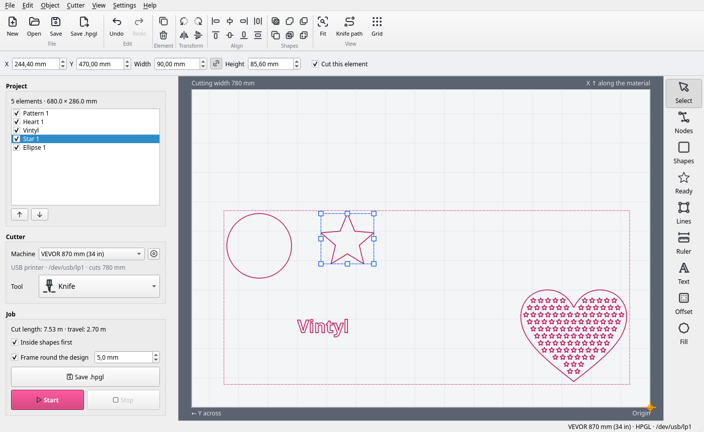
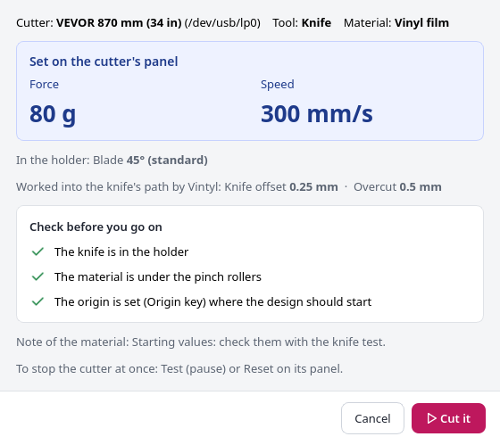

<p align="center"></p>

# Vintyl

**Free software for vinyl cutters on Linux.** Draw a design or open an SVG
or DXF file, lay it out on the sheet as the material lies in the cutter,
check the force and speed, and cut it, straight from the window.

Vintyl runs the popular, inexpensive drag-knife cutters (VEVOR, Seiki and
the many models built on the same control board) that come with
Windows-only software such as SignMaster, so they can be used on Linux.

**Website and user guide:** <https://cyryllo.github.io/vintyl/>
([po polsku](https://cyryllo.github.io/vintyl/pl/),
[instrukcja](https://cyryllo.github.io/vintyl/pl/guide.html)).

> **Version 0.9.2, ready for use.** Tested and cutting cleanly on the
> **VEVOR KI-375A** and the **Seiki SK-870T**; it should work the same on
> similar cutters and clones with the same board. Small glitches in the
> interface may still turn up: please
> [report them](https://github.com/cyryllo/vintyl/issues/new/choose).



## What it does

**Cutting**
- **Start and Stop** from the window. Before Start a short check list shows
  the material's force and speed to set on the cutter's panel, in large
  type, and what to check; nothing is sent until you confirm.
- **Knife compensation** at the corners (curves stay smooth) and an
  **overcut**, so every closed shape closes; **inside shapes first**.
- **Perforation**: elements cut in dashes, to fold card or tear paper off
  (a dashed line with a pen).
- A **weeding frame** round the design and **weeding lines** through the
  waste; **mirror** for heat transfer vinyl; a **knife test** to set the
  force; **copies** in rows and columns; **strips** for designs wider than
  the cutter; the **knife path** on the sheet with the order of the cuts.
- **Materials** for each tool: for the knife vinyl film, heat transfer
  vinyl, reflective vinyl, card and paper to cut; for the pen paper and
  card to draw on; and your own, each with its force and speed for each
  cutter.
- **Cutter profiles** with their own settings window: port (with the
  devices found and whether you may use them), command language, axes,
  knife offset, overcut. Add your own cutters.

**Drawing and laying out**
- Rectangle (with round corners), ellipse, polygon, line, polyline, pen
  curves, freehand, **text** in your fonts, also **along a path**, its
  letters **welded** into one outline for script fonts.
- **Ready shapes** (star, heart, ring, rounded rectangle, arrow, cross,
  drop, gear) and **QR codes**; a **pattern of shapes** inside a shape.
- Union, difference, intersection, exclusion, **offset**, node editing.
- Move, resize with handles, rotate by any angle, mirror, align,
  distribute, group; **To 0,0** moves the selection or the whole design up
  to the origin, so no vinyl is wasted; **lay out tightly** puts the parts
  side by side in as short a piece of vinyl as can be; undo everything.
- Open **SVG** and **DXF** files; **trace a picture** (PNG, JPG) into
  shapes to cut; save and open projects (.vintyl); save the cutter's file
  (.hpgl).

**Pens**: switch the tool to the marker pen to draw on paper or card, with
the stroke on, outside or inside the line and nine fill patterns. **A
picture as a drawing**: a photo (PNG, JPG) drawn with lines, as seismograph
waves, a spiral or hatching, with a live preview.

**Colours**: an SVG of several colours opens in its colours (similar ones
merged, so one pen draws them; you see and change what goes where). The
Colours panel sets the order they are drawn in, leaves a colour out and
gives it its own pen width and its own fill pattern. An outline and its fill
can be two colours (a black outline, a pink fill), also straight from an
SVG. Start goes colour after colour, with a pause to
put in the next pen (or the next colour of vinyl); the origin stays, so the
colours land on each other. Try it with
[docs/demo/vintyl-demo.svg](docs/demo/vintyl-demo.svg).

**And**: English, Polish, German, Spanish, French and Brazilian Portuguese; a
light and a dark look; keyboard shortcuts for
everything common (Help → Keyboard shortcuts); Help → Diagnostic report for
bug reports and to tell us how Vintyl works on your cutter; it tells you
when a new version is out; `vintyl --self-test` checks that everything it
needs is there.



## Cutters

| Cutter | Connects as | Status |
|---|---|---|
| VEVOR KI-375A (cuts 285 mm) | USB printer, HPGL | **tested**: cuts cleanly |
| Seiki SK-870T (cuts 780 mm, system 6.8H) | USB printer, HPGL | **tested**: cuts cleanly |
| VEVOR 870 mm (cuts 780 mm) | USB printer, HPGL | profile ready (the same board as the two above) |
| other VEVOR, Seiki and similar clones with the same board | USB printer, HPGL | "VEVOR / Seiki, other model": set its cutting width; it should work the same |
| other HPGL or DMPL drag-knife cutters | USB printer or serial port | add a profile of your own |

So far Vintyl has been used with these cutters in their **USB printer**
mode. Their second mode, **Virtual COM** (a serial port, with another
driver), is prepared in the profiles (port, baud rate, flow control) but has
not been tried on a cutter yet.

These cutters take force and speed only from their own panel: set them
there (Vintyl shows the material's values before Start). The knife offset
and the overcut need nothing on the cutter: Vintyl works them into the
knife's path.

## Download and install

The AppImage from [Releases](https://github.com/cyryllo/vintyl/releases):
one file with everything inside, built on Ubuntu 22.04, so it runs on most
64-bit Linux systems of the last years.

```bash
chmod +x Vintyl-*-x86_64.AppImage
./Vintyl-*-x86_64.AppImage
```

At the first start Vintyl offers to add itself to the applications menu.

**Access to the cutter.** On Linux a cutter is a device file, and only the
members of its group may send to it. Join the group once, then log out and
in again:

| The cutter connects as | Device | Group |
|---|---|---|
| a USB printer (VEVOR, Seiki) | `/dev/usb/lp0`, `/dev/usb/lp1`… | `lp` |
| a serial port or a USB-serial cable | `/dev/ttyUSB0`, `/dev/ttyACM0`… | `dialout` (Arch, Manjaro: `uucp`) |

```bash
sudo usermod -aG lp $USER
sudo usermod -aG dialout $USER
```

Vintyl checks the chosen cutter's port and says what to do (Help → Access
to the cutter). The [user guide](https://cyryllo.github.io/vintyl/guide.html)
goes through the first cut step by step.

## Run it from the source

```bash
python3 -m venv .venv
.venv/bin/pip install -e '.[gui,dev]'
.venv/bin/python -m vintyl              # the window; add an .svg, .dxf, .vintyl or a picture (.jpg, .png) to open it
.venv/bin/python -m vintyl --self-test
.venv/bin/python -m pytest              # the tests (the window ones run offscreen)
```

Build the AppImage: `packaging/linux/build-appimage-docker.sh` (needs
Docker; builds in Ubuntu 22.04 and runs the self-test). A version tag
(`vX.Y.Z`) builds and publishes it on GitHub
([.github/workflows/release.yml](.github/workflows/release.yml)). The
screenshots are made by `tools/screenshots.py` from the program itself; the
website is built from [docs/](docs/) on GitHub Pages.

## License and credits

Vintyl is free software under the **GPL-3.0-or-later**, see
[LICENSE](LICENSE). Changes: [CHANGELOG.md](CHANGELOG.md); planned:
[TODO.md](TODO.md) (in Polish).

- **Code from other programs** (GPL-3.0-or-later, marked in each file's
  header): the drawing and editing code comes from
  [Kerfly](https://github.com/cyryllo/Kerfly); the DXF reader from
  [K40 Whisperer](https://www.scorchworks.com/K40whisperer/k40whisperer.html)
  by Scorch, through Kerfly.
- **Ideas and references, no code copied**:
  [Inkcut](https://github.com/inkcut/inkcut) (Jairus Martin and
  contributors) for the knife compensation, the overcut and the cutter
  commands, and as a reference in the tests (`tools/inkcut_wzorzec.py` runs
  it separately; nothing of it is in Vintyl); CutScape (jetpax); RedsailCut.
- **Libraries** in the AppImage (Qt with PySide6, pyserial, pyclipper,
  segno, svgelements, Tabler Icons) and their licences:
  [THIRD-PARTY-NOTICES.md](THIRD-PARTY-NOTICES.md).
